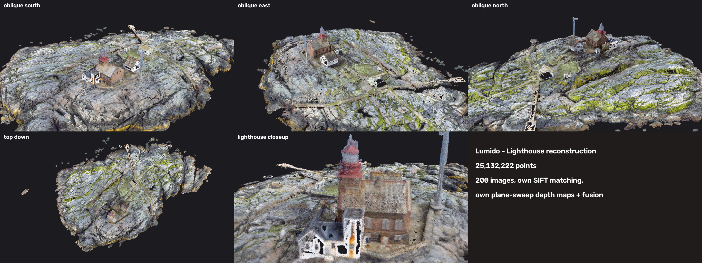
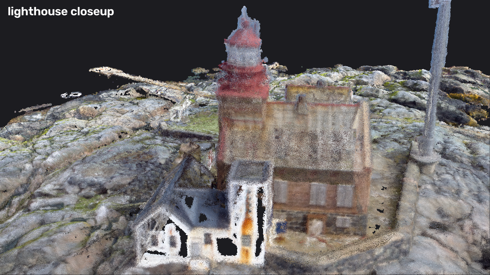
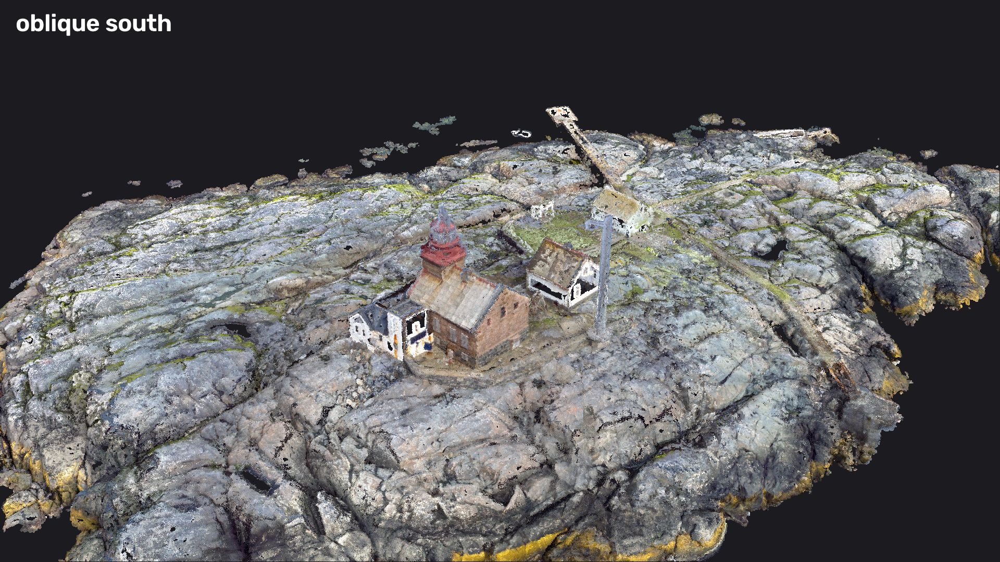
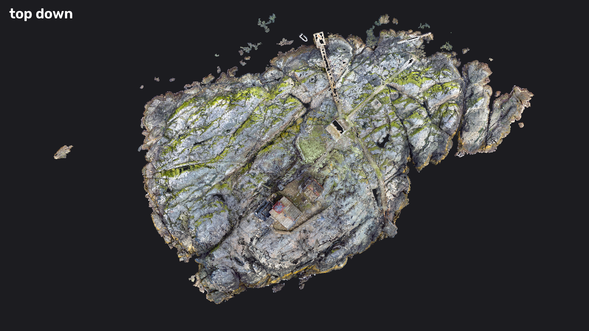
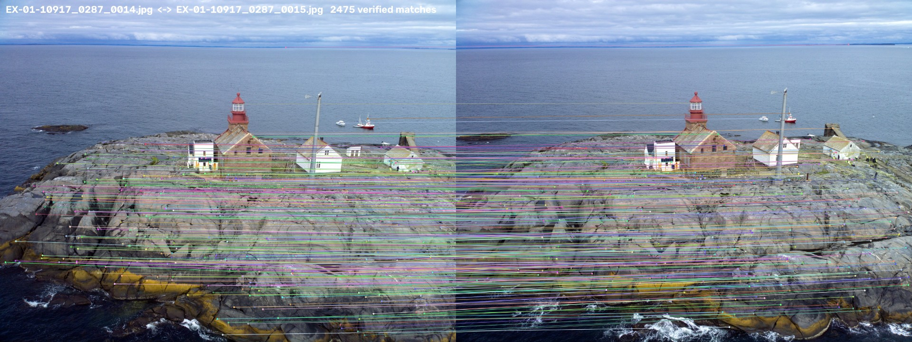
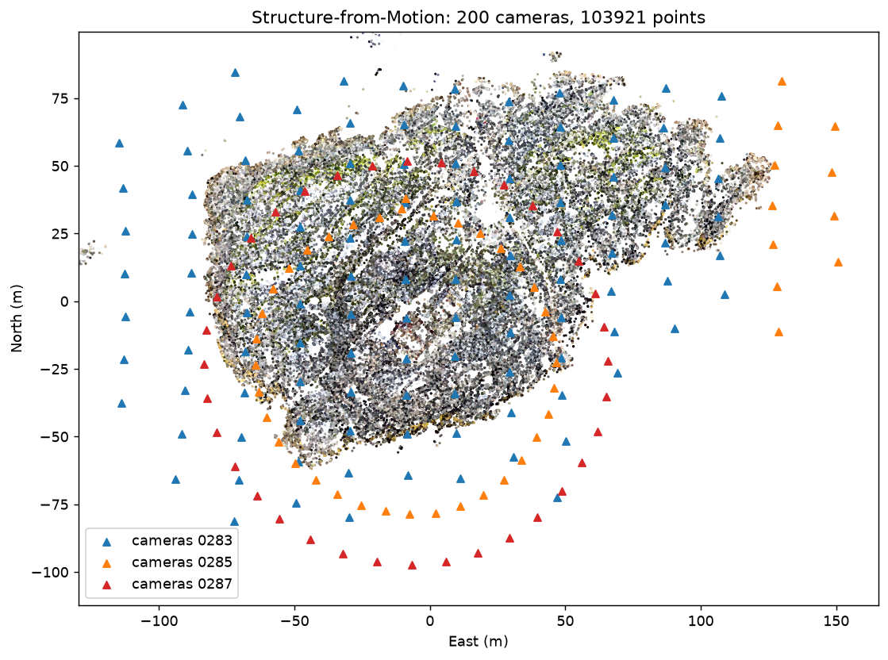

# Lumido — Lighthouse 3D Reconstruction (Team Halo)

**Pixel Ops hackathon — photogrammetry, drone 3D reconstruction.**

[](https://github.com/tttamannaanand/Lumido/actions/workflows/ci.yml)
[](LICENSE)


> **At a glance:** 200 drone photos → 200/200 cameras registered → 0.91 px reprojection error → **25.1 M-point** coloured cloud at 6 cm spacing, in real-world metres. Feature matching, plane-sweep stereo, fusion and rendering are written from scratch.

Pixel-Ops Trial Round. Lumido is a photogrammetry pipeline that turns the 200-image "Lighthouse" drone dataset into
depth maps and a dense, coloured 3D point cloud in real-world metres.



## Deliverables

| Rulebook item | Where |
|---|---|
| Source code | `pipeline/step1_prepare.py` … `step6_render.py`, `run_all.sh` |
| Depth maps | `outputs/depth_maps/` (3 samples here; the full run produces 198, photo + coloured depth side by side) |
| Point cloud | `outputs/dense_cloud_lite.ply` (3.2 M points, included) · full `dense_cloud.ply` (25.1 M points, 377 MB) is regenerated by `run_all.sh` — too large for GitHub |
| Screenshots | `outputs/render_*.png` |
| Documentation (1 page) | `docs/Process_Documentation.pdf` |

Extra material for the presentation: `outputs/step2_matches_*.jpg` (feature matches),
`outputs/step3_cameras.png` (recovered camera positions), `outputs/sparse_cloud.ply`.

## Gallery

| | |
|---|---|
|  |  |
|  |  |
|  |  |

## Pipeline

| Step | File | What it does | Our code vs library |
|---|---|---|---|
| 1 | `step1_prepare.py` | Resize to 1600 px, read GPS + focal length from EXIF | own |
| 2 | `step2_match.py` | SIFT features, GPS-guided pairs, ratio + mutual + RANSAC checks | own, using OpenCV |
| 3 | `step3_sfm.py` | Camera poses by incremental SfM + bundle adjustment, then GPS scale | pycolmap **as a backend library** |
| 4 | `step4_depth.py` | Plane-sweep multi-view stereo with ZNCC → depth maps | own, using OpenCV/NumPy |
| 5 | `step5_fuse.py` | Multi-view consistency check, fusion, cleaning → PLY | own, Open3D for outlier removal |
| 6 | `step6_render.py` | Z-buffer point renderer for screenshots | own, NumPy |

Results: 200/200 cameras registered, reprojection error 0.91 px, cameras agree with GPS to 2.2 m
(median), final cloud 25.1 M points at 6 cm spacing covering 261 × 156 × 36 m.

## Running it

```bash
python3 -m venv .venv
.venv/bin/pip install -r requirements.txt
brew install libusb          # macOS only, needed by Open3D
# put the 200 original images in data/raw/
./run_all.sh                 # ~45 min on an M3 laptop
```

Each step can also be run on its own, e.g. `.venv/bin/python pipeline/step4_depth.py 0287_0020`
(depth map for a single image — handy for a live demo, ~15 s).

Interactive 3D viewer: `.venv/bin/python pipeline/view.py outputs/dense_cloud_lite.ply`
(left-drag rotate, scroll zoom, shift-drag pan).

## Tests

```bash
pip install -r requirements-dev.txt
pytest -q          # 13 tests: GPS/EXIF maths, pair selection, voxel fusion, PLY format, renderer z-buffer
ruff check . && ruff format --check .
```

The tests run without the 200 source images: they check the geometry with hand-computed cases, and confirm the committed point cloud is a well-formed 3.2 M-point PLY. CI runs them on every push and pull request.

## Rules compliance

- No ready-made point-cloud software (no COLMAP GUI, Meshroom, Metashape, ODM, …).
- COLMAP is used only through the `pycolmap` Python library, and only for pose optimisation
  (step 3). Feature detection, matching, depth estimation, fusion and rendering are our own code.
- Only the issued Lighthouse images are used; GPS comes from their own EXIF data.

## Known limitations

See `docs/Process_Documentation.pdf`: sea not reconstructed (moving water), walls sparser than
roofs, depth at reduced resolution for an 8 GB laptop, ±2 m absolute position from consumer GPS.

## License

Code is [MIT](LICENSE). The Lighthouse images belong to the Pixel Ops organisers and aren't included.
